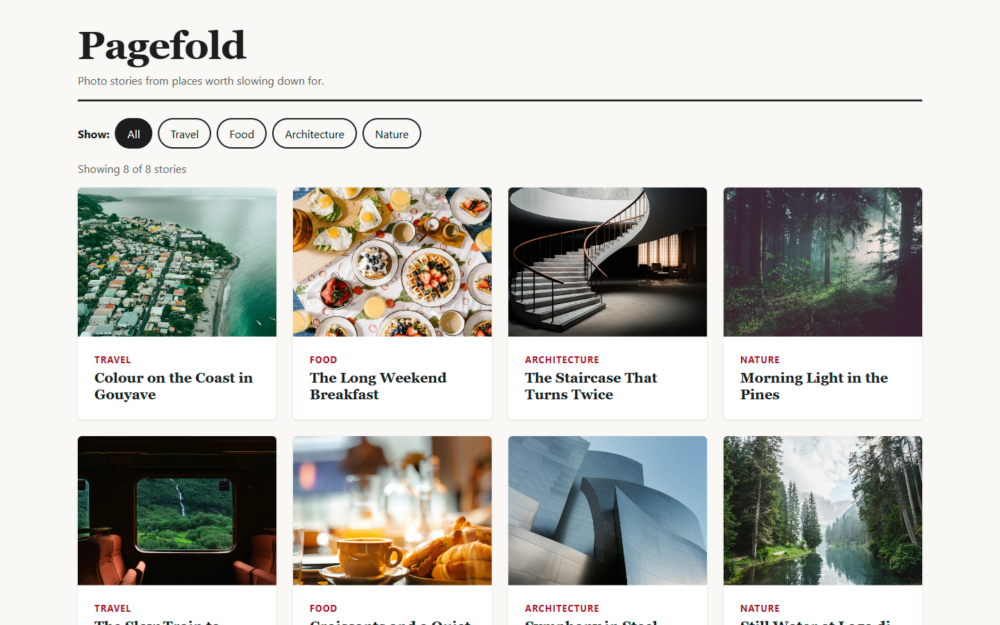
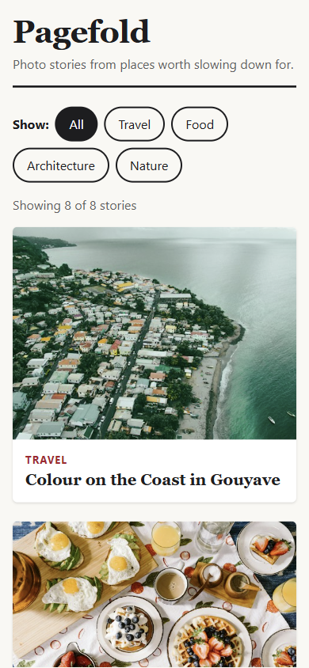

# Pagefold

A mobile-first responsive image grid for a made-up magazine, built as a small demo project.

**Live:** https://chris-mech.github.io/pagefold-magazine/

| Desktop                                                                                                                                                  | Phone                                                                                                                                      |
| -------------------------------------------------------------------------------------------------------------------------------------------------------- | ------------------------------------------------------------------------------------------------------------------------------------------ |
|  |  |

## Features

- Responsive CSS Grid: 1 column on phones, 2 on tablets, 3–4 on desktop
- Category filter above the grid
- Cards loaded from a local JSON file and passed to components through props
- Descriptive alt text, semantic HTML and a visible keyboard focus style
- Deployed to GitHub Pages with GitHub Actions

## Tech stack

- Vue 3 (`<script setup>` single-file components)
- Vite
- Sass in the indented syntax (`.sass`), split into partials loaded with `@use`

## Sass features

**Variables and a breakpoints map** (`src/styles/_variables.sass`)

```sass
$color-accent: #b3122b
$space-m: 16px
$breakpoints: (tablet: 600px, desktop: 960px, wide: 1280px)
```

**px-to-rem function** (`src/styles/_functions.sass`)

```sass
@function rem($px, $base: v.$font-size-base)
  @return math.div($px, $base) * 1rem
```

**Breakpoint mixin**, used for every media query (`src/styles/_mixins.sass`)

```sass
@mixin breakpoint($name)
  @if not map.has-key(v.$breakpoints, $name)
    @error "Unknown breakpoint '#{$name}'. Use one of: #{map.keys(v.$breakpoints)}"
  @media (min-width: map.get(v.$breakpoints, $name))
    @content
```

**Card style mixin** (`src/styles/_mixins.sass`)

```sass
@mixin card-surface
  background-color: v.$color-surface
  border-radius: f.rem(v.$radius)
  box-shadow: 0 1px 3px rgba(0, 0, 0, 0.12)
  overflow: hidden
```

**Main file** bringing the partials together with namespaced `@use` (`src/styles/main.sass`)

```sass
@use "variables" as v
@use "functions" as f
@use "mixins" as m
```

**Mobile-first grid** using the mixin (`src/components/MagazineGrid.vue`)

```sass
.grid
  display: grid
  grid-template-columns: 1fr

  @include m.breakpoint(tablet)
    grid-template-columns: repeat(2, 1fr)

  @include m.breakpoint(desktop)
    grid-template-columns: repeat(3, 1fr)

  @include m.breakpoint(wide)
    grid-template-columns: repeat(4, 1fr)
```

## Image credits

Photos from [Unsplash](https://unsplash.com/), used under the [Unsplash License](https://unsplash.com/license):
[Hugh Whyte](https://unsplash.com/photos/KIfVGXf6Kzc),
[Abby Rurenko](https://unsplash.com/photos/QoBilxz1dNc),
[Rachel Park](https://unsplash.com/photos/hrlvr2ZlUNk),
[Jakub Żerdzicki](https://unsplash.com/photos/Vr2TeXxV7jo),
[Serhat Beyazkaya](https://unsplash.com/photos/ayWgRkCk2sQ),
[Tobias Keller](https://unsplash.com/photos/2ecH5Lw3zSk),
[Sebastian Unrau](https://unsplash.com/photos/sp-p7uuT0tw),
[Luca Bravo](https://unsplash.com/photos/ESkw2ayO2As).

This project was planned and built step by step with [Claude Code](https://claude.com/claude-code).
